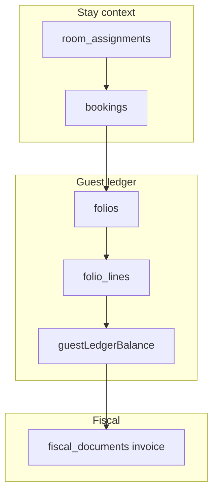
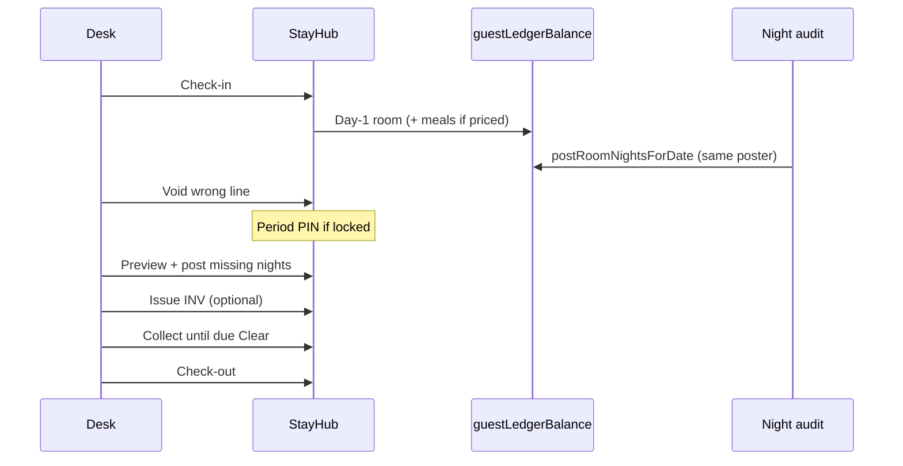

# Front Office system — constitution (2026–2029)

Hotel OS / Innora FO is a **trustworthy, guided, multi-tenant Front Office OS** — not an eZee feature-parity clone. This document is the checklist for any new FO money feature.

## Product thesis

- **One stay = one money truth**
- **Agent-native**, tax-honest, Bhutan/region independents and small chains
- AI may assist and explain; **never** silent post / void / pay

## Bounded contexts

| Context | Tables / modules | Owns |
|---------|------------------|------|
| Stay | `bookings`, `room_assignments`, `booking_guests` | Lifecycle, room, guests |
| Guest ledger | `folios`, `folio_lines`, `payments` | Journal + due |
| Fiscal | `fiscal_documents` | INV / RCP numbers; print = live lines |
| Collect-from party | `payment_mode` + `agent_id` | Guest cash vs agent AR |
| Locks | `booking_stay_leases`, `accounting_periods` | Concurrency + period override |



## Canonical money rules (non-negotiable)

1. **One balance API:** `guestLedgerBalance(lines)` = `netFolioBalance` in [`web/src/lib/folio/guest-ledger.ts`](../../web/src/lib/folio/guest-ledger.ts) / [`balance.ts`](../../web/src/lib/folio/balance.ts). StayHub, Open bills, Unpaid bills, calendar chip, settle bar — same function.
2. **Nightly base ≠ posted room line.** `agreed_nightly_rate_btn` = “Nightly base”; posted `source_type=room` = “Room charge (incl. tax/SC as configured)”.
3. **Collect-from party:** `deriveCollectParty({ paymentMode, agentId })` → `guest` | `agent`. Hide Agent bill CTAs when party = guest.
4. **Invoice** = pointer to folio + `doc_no`; print always live guest-visible lines. Empty after void-all → banner “repost then reopen INV”. No second INV without credit note.
5. **Void** = `voidFolioLineWithReversal`; due excludes void originals + their reversal credits. Period lock → structured error + auto-expand PIN + toast recipe.
6. **Stay lock** = soft lease (`booking_stay_leases`); money mutations require take-over or fail with toast naming who holds.
7. **Lifecycle stepper (honest):** Booked → Checked-in → Charges open → Invoice optional → Settled (balance≈0) → Checked-out. Never mark Settled/Paid while `|balance| > 0.5`.

## Sequence — check-in → collect → checkout



## Lock / period matrix

| Situation | Desk sees | Next action |
|-----------|-----------|-------------|
| Soft-closed / closed period on void/post | Toast: expand Period override | Manager PIN + short reason |
| Another desk holds stay lease | Amber banner with holder name | Take over (toast confirms) |
| Invoice after void-all | Print banner Nu 0 | Repost nights → reopen/reprint INV |
| Cash / pay-at-leave + agent on booking | Party: Guest | Collect payment (no Agent bill CTA) |

## Primary FO routes

| Job | Route |
|-----|-------|
| Worklist | `/erp/today` |
| Rack | `/erp/calendar` → StayHub |
| Stay money (canonical) | StayHub → Folio |
| Full ledger | `/erp/folios/[id]` |
| Collect list | `/erp/unpaid-bills` |
| Open bills (master/walk-in) | `/erp/folios` |
| Tax print | `/erp/invoices/[id]/print` |
| Night audit | `/erp/night-audit` |
| Training | `/erp/training#stay-money` |

## Balance call-site inventory (cutover)

Surfaces that **must** use `netFolioBalance` / `guestLedgerBalance`:

| Location | Status |
|----------|--------|
| `stay-hub.ts` summary + `fetchStayHubMoney` | ✅ `guestLedgerBalance` |
| `erp/folios/page.tsx` (Open bills) | ✅ `netFolioBalance` |
| `erp/folios/[id]/page.tsx` | ✅ `netFolioBalance` |
| `lib/erp/unpaid-bills.ts` | ✅ `netFolioBalance` |
| `erp/calendar/page.tsx` chip | ✅ `netFolioBalance` |
| `lib/folio/ledger-summary.ts` strip balance | ✅ via `guestVisibleBalanceLines` |
| `erp/invoices/[id]/print` | ✅ `guestVisibleBalanceLines` |
| `lib/folio/post-payment.ts` settle-zero | ✅ |
| `BookingBoardTable` list due | ✅ `netFolioBalance` |
| `lib/erp/day-ops-board.ts` | ✅ `netFolioBalance` |
| `erp-checkin.ts` balance readout | ✅ `guestLedgerBalance` |
| `lib/booking-detail.ts` | ⚠ not primary FO path |
| `lib/reports/fo-desk-reports.ts` | ⚠ report path — prefer helper |

New FO UI **must not** invent `sum(total_btn)` for guest due.

## StayHub Folio wireframe

```
[ Take over banner if locked ]
[ Due Nu X          ]  ← guestLedgerBalance only
[ Nightly base · Posted room · Party ]
[ Ledger — void behind Void disclosure ]
[ Primary CTA: Collect | Post missing nights | Reopen INV ]
[ Secondary: Open full folio ]
```

## AI rule (3 years)

Assist and explain (“why is due X?”). Human confirms every money write.

## Out of scope

POS KDS rewrite, HR, laundry, channel, CMS, new GST/RRCO pack, multi-invoice without credit-note product.
