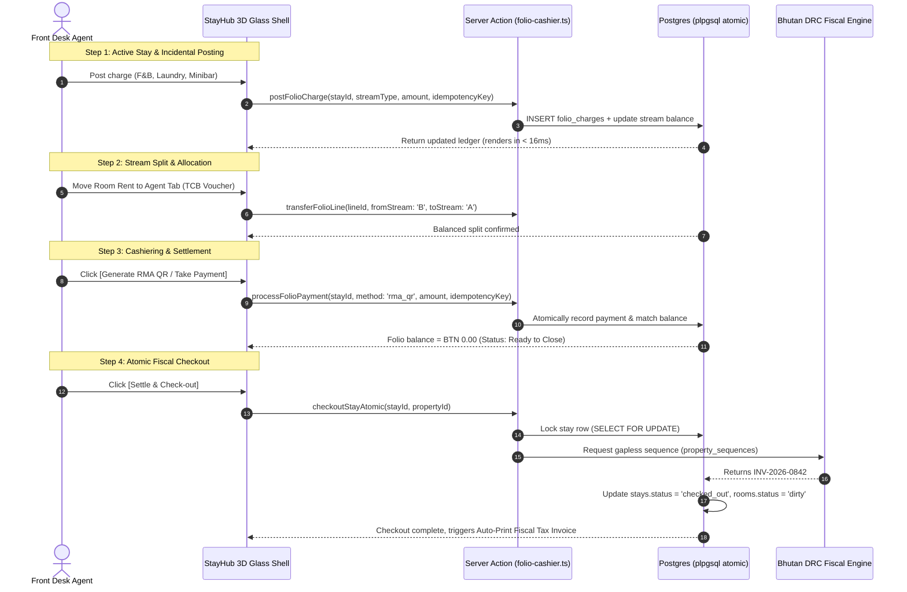

# StayHub & Folio Process Flow Redesign Specification

> **Target:** Cursor Composer / Implementer  
> **Scope:** Redesign of `web/src/components/erp/StayHubDialog.tsx` (decoupling the 5,000-line monolith), Folio Ledger Stream Splitting, and Atomic Checkout Cashiering.  
> **Aesthetic:** 3D Elevated Glassmorphism (`.glass-elevated`), Himalayan Jewel Accents, 60 FPS Cold Glass.

> **Evolution note (2026-11-08):** Dual folio + cashier dock in this doc remain the money model for production `web/`. v2 desk presentation evolves StayHub → **Stay** (Adaptive Stay Stage: dock/dossier densities, Fast Book as create mode, fiscal INV as print studio). See [`docs/superpowers/specs/2026-11-08-adaptive-stay-stage-design.md`](../superpowers/specs/2026-11-08-adaptive-stay-stage-design.md). Naming changes; single-editor invariant and A/B ledger do not.

---

## 1. Executive Summary & Problems Being Solved

| Current Problem in StayHub | Redesigned Enterprise Solution |
| :--- | :--- |
| **5,093-line Monolith (`StayHubDialog.tsx`)** | Decomposed into 4 modular, isolated 3D glass sub-components. |
| **Confusing Single-Bucket Folio** | **Dual-Stream Ledger (A/B Split):** Folio A (Agent Room/Board Voucher) vs Folio B (Guest Personal Incidentals/POS/Laundry). |
| **Clunky Multi-Click Payment Flow** | **Floating 3D Cashier Dock:** Instant 1-click settlement via Bhutan RMA QR, Card, or Cash with UUID idempotency. |
| **Non-Atomic Checkout** | Single atomic PostgreSQL stored procedure: validates `balance == 0`, locks room, rolls status, and prints gapless `INV-YYYY-####`. |

---

## 2. Redesigned StayHub 3D Spatial Layout

```
┌────────────────────────────────────────────────────────────────────────────────────────┐
│ [STAYHUB 3D GLASS HEADER]                                                      [X Close]│
│ Room 204 • Deluxe Mountain View   [In-House (Lapis)] [VIP (Gold)]    Balance: BTN 0.00  │
│ Guest: Tashi Dorji (Paro Tours Group) • Nights: 3 (Oct 18 - 21)       [Print Folio ▾]   │
├────────────────────────────────────────────────────────────────────────────────────────┤
│ [DUAL-STREAM FOLIO TABS]                                                               │
│   ┌────────────────────────────────────────┬────────────────────────────────────────┐  │
│   │ [Tab A: Agent / Company Tab (BTN 18,000)]│ [Tab B: Guest Incidentals (BTN 2,450)] │  │
│   ├────────────────────────────────────────┴────────────────────────────────────────┤  │
│   │ LEDGER TABLE (High-contrast opaque rows, zero blur for speed):                  │  │
│   │ Date       Item / Description       Department     Debit (BTN)  Credit    Status │  │
│   │ Oct 18     Room Night 1 (EP Plan)   Room Rent        6,000.00     -       Posted │  │
│   │ Oct 18     Dinner - Tiger's Nest POS F&B             1,850.00     -       Posted │  │
│   │ Oct 19     Laundry Express (2 shirts)Laundry           600.00     -       Posted │  │
│   │ Oct 19     BDBL Bhutan QR Payment   Payment              -      2,450.00  Settled│  │
│   ├─────────────────────────────────────────────────────────────────────────────────┤  │
│   │ Subtotal: BTN 8,450.00   •   Taxes (5% Bhutan GST): BTN 422.50   •  Due: BTN 0.00│  │
│   └─────────────────────────────────────────────────────────────────────────────────┘  │
├────────────────────────────────────────────────────────────────────────────────────────┤
│ [FLOATING 3D CASHIER DOCK (GPU-Composited Cold Glass)]                                 │
│  [+ Post Room Charge]  [+ Transfer to Tab A/B]   [Generate RMA QR]  [Settle & Check-out]│
└────────────────────────────────────────────────────────────────────────────────────────┘
```

---

## 3. The 4-Step Folio Lifecycle Process Flow



---

## 4. Modular File Architecture (Refactoring `StayHubDialog.tsx`)

Decompose the existing 5,093-line file into these 4 focused components:

| Component Path | Lines | Responsibility |
| :--- | :--- | :--- |
| `web/src/components/erp/stay-hub/StayHub3DShell.tsx` | ~250 | Modal container with `.glass-elevated`, ambient jewel glow, and keyboard shortcuts (`Esc`, `Ctrl+P`). |
| `web/src/components/erp/stay-hub/StayHubHeaderBar.tsx` | ~200 | Guest passport/contact summary, room number pill, VIP/Agent badge, and live net balance. |
| `web/src/components/erp/stay-hub/StayHubDualLedger.tsx` | ~380 | Dual-stream Tab A (Agent) vs Tab B (Guest), item filter pills, and void reversal actions. |
| `web/src/components/erp/stay-hub/StayHubCashierDock.tsx` | ~220 | Floating bottom bar: Quick charge buttons, RMA QR payment modal, and atomic Checkout trigger. |

---

## 5. Atomic PostgreSQL Function Contract for Checkout

Create under `supabase/migrations/20261102_stayhub_atomic_checkout.sql`:

```sql
CREATE OR REPLACE FUNCTION stayhub_checkout_atomic(
  p_property_id UUID,
  p_stay_id UUID,
  p_cashier_id UUID,
  p_idempotency_key UUID
) RETURNS JSONB AS $$
DECLARE
  v_net_balance NUMERIC;
  v_invoice_num TEXT;
  v_room_id UUID;
BEGIN
  -- 1. Idempotency Check
  IF EXISTS (SELECT 1 FROM idempotency_keys WHERE key = p_idempotency_key) THEN
    RETURN jsonb_build_object('success', true, 'message', 'Duplicate checkout request safely ignored');
  END IF;

  -- 2. Lock Stay & Check Balance
  SELECT room_id INTO v_room_id FROM stays 
  WHERE id = p_stay_id AND property_id = p_property_id FOR UPDATE;

  IF NOT FOUND THEN
    RETURN jsonb_build_object('success', false, 'error', 'Stay record not found');
  END IF;

  -- Calculate live folio balance
  SELECT COALESCE(SUM(CASE WHEN is_credit THEN -amount ELSE amount END), 0)
  INTO v_net_balance
  FROM folio_charges
  WHERE stay_id = p_stay_id AND is_voided = false;

  IF v_net_balance > 0.01 THEN
    RETURN jsonb_build_object('success', false, 'error', 'Cannot checkout: Outstanding folio balance of BTN ' || v_net_balance);
  END IF;

  -- 3. Generate Gapless Bhutan Fiscal Tax Invoice
  UPDATE property_sequences
  SET last_number = last_number + 1
  WHERE property_id = p_property_id AND sequence_type = 'fiscal_invoice'
  RETURNING 'INV-' || TO_CHAR(NOW(), 'YYYY') || '-' || LPAD(last_number::TEXT, 5, '0')
  INTO v_invoice_num;

  -- 4. Atomic Transitions: Mark stay checked_out, room dirty
  UPDATE stays 
  SET status = 'checked_out', check_out_time = NOW(), fiscal_invoice_number = v_invoice_num
  WHERE id = p_stay_id;

  UPDATE rooms SET housekeeping_status = 'dirty' WHERE id = v_room_id;

  -- 5. Record Idempotency
  INSERT INTO idempotency_keys (key, action, property_id, actor_id)
  VALUES (p_idempotency_key, 'stayhub_checkout', p_property_id, p_cashier_id);

  RETURN jsonb_build_object(
    'success', true, 
    'invoice_number', v_invoice_num, 
    'checked_out_at', NOW()
  );
END;
$$ LANGUAGE plpgsql SECURITY DEFINER;
```

---

## 6. Cursor Implementation Prompt

Feed this command to Cursor to execute the redesign:

> *"Implement the StayHub & Folio redesign specified in [`docs/architecture/STAYHUB-FOLIO-REDESIGN.md`](file:///c:/GitHub/Hotel%20OS%20Bhutan/docs/architecture/STAYHUB-FOLIO-REDESIGN.md). Create the atomic migration `stayhub_checkout_atomic`, split `StayHubDialog.tsx` into the 4 modular 3D glass sub-components, and enforce the dual-stream ledger flow. Verify with `pnpm --dir web run typecheck`."*
