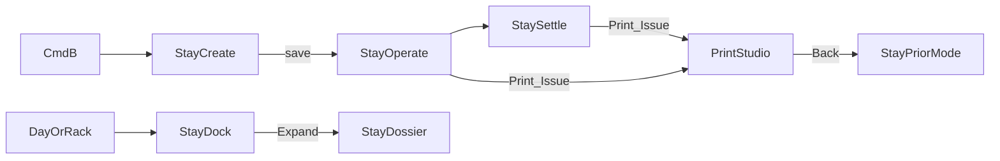

# Adaptive Stay Stage — design (2026-11-08)

Cites: `docs/v2/MODULES.md`, `docs/architecture/STAYHUB-FOLIO-REDESIGN.md`, `docs/v2/DESIGN-SYSTEM.md`, `.cursor/rules/desk-ops-invariants.mdc`, `.cursor/skills/pelbu-hotel-ops`.

## Goal

Replace the StayHub *presentation* (modal / overloaded dock monolith) with **Stay** — one adaptive stay workspace that is fast for FIT walk-ins and deep enough for Bhutan agent parties — without breaking the **single stay editor** invariant.

**Delivery order:** this spec (Phase 1) → implement in `v2/apps/desk` (Phase 2). Production `web/` StayHub is out of scope for Phase 2.

## Decisions locked

| Decision | Choice |
|----------|--------|
| Optimize for | FIT speed **and** agent-party depth |
| Fast Book + Invoice | Hybrid: Fast Book = Stay `create` (1 screen); fiscal INV = dedicated print studio |
| Shell | **Adaptive Stay Stage** — dock default, Expand → dossier page |
| Product name | StayHub → **Stay** (invariant kept: Stay is the only stay editor) |
| This round | Design/spec only; no desk UI code until this file is approved |

## Concept & information architecture

**Rename:** StayHub → **Stay**. Day / StayView / Reservations / POS only *open* Stay; they never edit stays inline.

**One component tree, two densities**

| Density | When | Chrome |
|---------|------|--------|
| **Stage (dock)** | Default from Day/rack; FIT walk-in, collect, quick CI/CO | Right dock ~420–480px; board stays visible |
| **Dossier (page)** | Expand, deep link, agent party, multi-room, docs-heavy | `/desk/stays/:id` with breadcrumb ← Day \| StayView \| Reservations |

**Modes of Stay** (same component tree; not separate apps)

1. **`create`** — Fast Book (1 screen): guest, dates, rooms/qty, source/agent, meal plan → save → flips to `operate`
2. **`operate`** — guest/room/rate, dual folio skim, next-best-action chips, CI / assign / charges
3. **`settle`** — cashier focus: balance, pay, checkout gate; **Print / Issue INV** peels to the print studio

**Sibling route (not a Stay mode):** print studio at `/desk/stays/:id/print` (options left, A4 preview right). Back returns to Stay in the prior mode (`settle` or `operate`).

**What dies**

- Nested invoice modal inside Stay
- Separate Fast Book modal that hands off into another product
- Full-page booking dossier *as a second editor* (legacy `/bookings/[id]` pattern)

**What stays**

- Single-editor rule
- Dual folio (agency vs guest) for Bhutan
- `PS-…` confirmation ≠ fiscal `INV-…`
- Cold glass: glass chrome, opaque folio numbers / rack cells

## Fast Book as Stay `create`

**Entry:** ⌘B / “New stay” / paint-to-book on StayView / Day empty slot → opens Stay Stage in **`create`** (dock by default; Expand available but rarely needed).

**One screen, three profiles (chips, not wizards)**

| Profile | Prefills | Hidden until needed |
|---------|----------|---------------------|
| **Walk-in / FIT** | today CI, 1 night, EP, cash source | agent, guide, SDF |
| **Agent / TCB** | source=agent, meal often MAP/AP | corporate billing |
| **Corporate** | company bill-to | guide/SDF |

**Always on the one screen**

- Guest name (required)
- CI / CO (+ nights derived)
- Room type × qty (door assign optional)
- Adults / kids
- Meal plan
- Source (+ agent picker when agent)
- Live tariff estimate from real rates (no hardcoded fallback tariff)

**Deferred (chips: “Add later”)**

- Phone / email
- Passport / SDF / guide evidence
- Agreed rate override (PIN if over threshold)
- Notes / special requests

**Submit**

- Idempotent `create` → stay exists with `PS-…`
- Stage flips to **`operate`** on same surface (no modal close / reopen)
- Optional primary: “Check in now” if walk-in + room assigned + room clean

**Not in `create`**

- Folio posting, payments, fiscal INV, registration card print (`operate` / `settle` / print studio)

## `operate` / `settle` + print studio

### Dock density (default)

Vertical zones, top → bottom:

1. **Identity strip** — guest, `PS-…`, status, room, Expand
2. **Next actions** — 1–3 chips only (“Assign room”, “Check in”, “Collect Nu 1,240”)
3. **Money skim** — dual totals: Agency | Guest (opaque numbers); tap → folio detail
4. **Primary CTA** — context: Check in / Post charge / Collect / Check out
5. **More** — docs, rate matrix, move room, party switch (collapsed)

FIT path never opens More. Agent path often hits Expand.

### Dossier density (Expand / deep link)

Same data, wider layout:

- Left: guest + party rooms + docs/SDF/guide
- Center: dual folio ledger (opaque rows)
- Right rail: cashier + next actions
- Breadcrumb: `Day` / `StayView` / `Reservations` ← Stay · Guest · Room

### `settle` mode

Same shell; Money + CTA dominate. Checkout blocked until balance rules + (agent) guide evidence pass. No nested print dialogs.

### Print studio (`/desk/stays/:id/print`)

Dedicated page (not modal):

| Left rail | Right |
|-----------|--------|
| Doc kind: proforma / folio bill / fiscal INV / reg card / voucher | Live A4 (or 80mm if F&B) preview |
| Bill-to, paper, email | Print / Issue |

Rules:

- Issuing fiscal **INV** only from studio (gapless sequence, idempotency)
- Proforma / `PS-…` never labeled as GST INV
- **Back** → Stay at prior mode (`settle` or `operate`)
- Day / StayView remain in history so breadcrumb works

### Auto-Expand heuristics

Open as **dossier** when any of:

- party rooms > 1
- source = agent with open AR
- checkout with unpaid split folios

Otherwise open as **dock**.

## Phase 2 — v2 file map (after this spec is approved)

| Piece | Likely touch |
|-------|----------------|
| Stay stage shell | Evolve `v2/apps/desk/src/modules/StayHubDrawer.tsx` + `v2/packages/ui/src/components/StaySheet.tsx` |
| Create mode | Fold `v2/apps/desk/src/modules/FastBookModal.tsx` into Stay `create` |
| Print studio | Evolve `InvoiceModal.tsx` → route `/desk/stays/:id/print` |
| Openers | `StayViewPage.tsx`, `DeskPage.tsx`, `front-office-store.ts` |
| Routes | `shell/App.tsx` — `/stays/new`, `/stays/:id`, `/stays/:id/print` |

Phase 2 smoke: create → operate → settle → print → back.

## Out of scope (this spec + Phase 2 UI)

- Production `web/` StayHub monolith rewrite
- Money RPC / Postgres changes (v2 Wave B store until cutover)
- Renaming every historical “StayHub” string in Cursor rules (product language is defined here; rule migration can follow)

## Visual / a11y constraints

- Glass on Stay chrome, Expand, print studio shell; **opaque** folio ledger rows and money figures
- `prefers-reduced-transparency`: solid ivory fills
- `prefers-reduced-motion`: no dock spring / tilt
- Mobile: Stay Stage as bottom sheet; dossier is full page; print studio stacks options above preview

## Acceptance criteria

1. Opening a stay from Day, StayView, or Reservations always uses **Stay** (dock or dossier) — no second editor.
2. ⌘B / New stay / paint-to-book opens Stay in **`create`**; save keeps the same surface in **`operate`**.
3. FIT walk-in path completes create → assign → check-in without opening More or Expand.
4. Agent multi-room stay can Expand to dossier with dual folio + docs visible without leaving Stay.
5. Fiscal INV is issued only from `/desk/stays/:id/print`; proforma never claims to be GST INV.
6. Print studio Back returns to Stay in the prior mode with breadcrumb intact.
7. Auto-Expand heuristics match the rules above; user can still force dock ↔ dossier.
8. No nested invoice modal; no standalone Fast Book modal after Phase 2 lands.
9. Cold-glass dual-tier respected (opaque numbers on money surfaces).

## Related docs

- Dual folio / cashier decomposition (v1 production path): `docs/architecture/STAYHUB-FOLIO-REDESIGN.md`
- Module ownership: `docs/v2/MODULES.md` (Stay drawer = only stay editor)
- Desk glass tokens: `docs/superpowers/specs/2026-11-02-desk-neo-glass-design.md`
