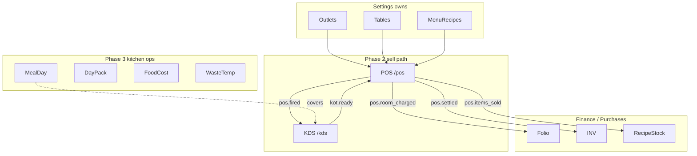

# POS & F&B department — design (2026-11-08)

Cites: `docs/v2/MODULES.md` §9–10, `docs/v2/OPERATIONS-FLOW.md` journey 3, `docs/v2/SOURCE-MAP.md` Wave D, `docs/v2/V1-VS-V2-GAP.md`, `docs/v2/IMPLEMENTATION.md` module-done gate, `docs/superpowers/specs/2026-11-08-adaptive-stay-stage-design.md`.

## Goal

Define the clean-v2 **Food & Beverage department** so POS till + KDS are module-done for the restaurant walk-in journey, with kitchen ops boards planned as a follow-on — without rewriting production `web/` POS and without turning POS into a second stay editor.

**Delivery order**

| Phase | Deliverable |
|-------|-------------|
| **1 (this round)** | This design/spec only |
| **2 (after spec approve)** | Sell path in `v2/apps/desk` + API persist |
| **3 (after Phase 2 module-done)** | Kitchen ops boards (meal day, day pack, food cost, waste/temp) |

## Decisions locked

| Decision | Choice |
|----------|--------|
| Delivery | Spec first → v2 desk (same pattern as Adaptive Stay Stage) |
| Sell path first | Outlet → till → fire → KDS → settle → INV / room charge / agent → recipe stock signal → shift close |
| Kitchen ops | Phase 3 only (sketched below; not built in Phase 2) |
| Prices | **Server menu price only** — reject client-sent unit prices (SOURCE-MAP REINVENT) |
| Room charge | Guest folio line; **no INV** at POS |
| Walk-in settle | Gapless fiscal **INV-** at settle |
| KDS chrome | Wall screen, always dark, **no glass** |
| Stay | POS opens **Stay** only for guest folio work; single Stay editor invariant |
| Out of program | `web/` POS rewrite; loyalty auto-earn; full RMS theoretical-vs-actual; chain multi-property outlet board |

## Department information architecture

**Owns (MODULES)**

| Module | Owns |
|--------|------|
| POS `/pos` | `pos_orders`, `pos_items`, `pos_bills`, `pos_payments`, `tables` (runtime state), `pos_shifts` |
| KDS `/kds` | `kot_tickets`, `kot_items` |
| Settings | outlets, dining tables definition, menu + modifiers + recipe + tax class |

**Roles:** Waiter/Captain, Cashier, F&B Manager (POS); Chef, Bartender (KDS). POS is **tablet-first**.

## Phase 2 — sell-path screens

### POS `/pos`

| Screen | Job |
|--------|-----|
| Outlet picker | Property may have restaurant / bar / room-service; lock shift to one outlet |
| Table map | Open / seated / billed / dirty; bar tabs as pseudo-tables |
| Order pad | Menu by category; modifiers; notes; seat/course; live totals from **server** prices |
| Bill | Split by item / seat / amount |
| Payment | Cash, card, mBoB / RMA QR, room charge (room → in-house guest), agent open-item / AR |
| Shift | Open / close float; training mode drafts only (no stock/GL) if retained |
| Void | Manager PIN + reason; strike on KDS |

**Order states:** `open → fired → served → billed → settled | void`

**Actions:** open table, add items (server price), fire, void (PIN+reason), discount (permission), split, settle tenders above, reprint, mark item 86 (or receive `item.86` from KDS).

### KDS `/kds`

| Screen | Job |
|--------|-----|
| Station boards | Kitchen, bar, bakery (filter) |
| Ticket cards | Timers, start, bump item, bump ticket |
| All-day counts | Prep load |
| Recall | Reopen bumped ticket |
| Expo / pass | Pass view for runners |
| 86 | Sold out → POS hides item |

**Chrome:** dark wall UI, high-contrast tickets, **no** frosted glass / blur on the board.

## Money, fiscal, and events

| Event | Emitter | Handler effect |
|-------|---------|----------------|
| `pos.fired` | POS | KDS creates/updates `kot_tickets` |
| `kot.ready` | KDS | POS waiter alert; ticket may move to served |
| `pos.room_charged` | POS | Finance posts guest folio line; **no INV** |
| `pos.settled` | POS | Finance payment + gapless **INV-** for the POS bill |
| `pos.items_sold` | POS | Purchases depletes stock by recipe; Reports |
| `pos.void` | POS | Finance audit; KDS strike-through; Reports |
| `item.86` | KDS | POS hides item on pad |
| `kot.timing` | KDS | Reports prep times |
| `stay.checked_out` | Stay / Reservations | POS **blocks** new room charge to that stay |
| `menu.updated` | Settings | POS refreshes catalog (server prices) |

**Idempotency:** every settle, void, room-charge, and INV issue requires client UUID idempotency key.

**Offline:** POS ticket may draft offline; **money settle / room charge / INV online-only** (SOURCE-MAP).

## Stay integration

- Room-charge lookup: room number → in-house booking → post folio line on guest (or agent) tab per payor rules.
- Deep guest folio work (split streams, checkout, fiscal guest INV/PSBN) opens **Stay** (Adaptive Stay Stage) — POS does not edit stays.
- F&B fiscal print for POS INV uses print studio pattern: options left / A4-or-80mm preview right (thermal allowed for F&B).
- Proforma / ticket number ≠ fiscal `INV-…`.

## MERGE / REINVENT (SOURCE-MAP Wave D)

| Concern | Doctrine |
|---------|----------|
| Till / KDS UX shells | **MERGE** v1 patterns (`/erp/pos`, `/erp/kds`, floor plan, tenders, void reasons) |
| POS domain rules | **COPY** into `packages/domain/src/pos` (`pos-tenders`, void reasons, ticket, kot-visibility, receipt, training) |
| Pricing & stock | **REINVENT** — server menu price; recipe depletion on `pos.items_sold` |
| KDS boards | **MERGE** fragmented v1 KDS/pass/bar/kitchen into one board + station filter |
| Do not COPY | Client-sent POS prices; money WAL offline replay |

## Phase 2 — v2 file map

| Piece | Path |
|-------|------|
| Till UI | Evolve `v2/apps/desk/src/modules/PosPage.tsx` |
| KDS UI | Evolve `v2/apps/desk/src/modules/KdsPage.tsx` |
| Demo store | Replace `v2/apps/desk/src/lib/fnb-store.ts` with API-backed queries/commands |
| Commands | Persist `v2/apps/api/src/modules/wave-d.ts` beyond `persisted: pending_db` (`pos.addItem` already rejects client price) |
| Domain | Add `v2/packages/domain/src/pos` (COPY rules + tests) |
| Routes | Existing `/pos`, `/kds` in desk shell; cmdk “POS Till” / “KDS Kitchen Pass” |

**Phase 2 smoke**

1. Restaurant walk-in: table → fire → KDS bump → bill → cash settle → INV → recipe stock signal → shift close
2. Room charge to in-house → folio line visible in Stay; no INV at POS
3. Day-close pre-audit can flag unsettled POS bills (event/query hook)

## Phase 3 — kitchen ops (roadmap only; after Phase 2 module-done)

MERGE from v1 `/erp/kitchen/*` and `/erp/fnb/day` into v2 routes (exact paths named at Phase 3 kickoff):

| Surface | Job |
|---------|-----|
| Meal-plan day board | Covers by meal (B/L/D) from in-house + MAP; feed `meal_plan.covers` to KDS |
| Day pack / print | Morning briefing / pass-out |
| Food cost | Flash cost vs sales |
| Waste / temp / cleaning | Ops compliance logs (non-money or charge-on-confirm only) |
| Shopping / labor | Secondary; after food-cost |

Phase 3 does **not** include loyalty auto-earn, full menu-engineering RMS, or multi-property outlet chain board.

## Module-done gate (Phase 2 claim)

Per `docs/v2/IMPLEMENTATION.md`, POS+KDS sell path is **done** only when all are true:

1. Write flows (commands) persisted
2. Permission keys
3. Audit entries
4. Emits and handles events in the map above
5. Live updates (Realtime or short poll for KDS)
6. Tablet/phone layout (POS); wall layout (KDS)
7. Domain tests on money paths (price reject, settle/INV, room-charge no INV)
8. OPERATIONS-FLOW journey **Restaurant walk-in** passes

## Acceptance criteria

1. Spec approved before any Phase 2 UI/API money wiring beyond current stubs.
2. Phase 2 PosPage supports outlet, table map, modifiers, void+PIN, split, all listed tenders, shift open/close.
3. Phase 2 KdsPage supports stations, timers, bump/recall/86, dark no-glass chrome.
4. `pos.addItem` / settle never accept client unit prices.
5. Room charge posts folio without issuing INV; cash/QR/card settle issues gapless INV.
6. `pos.items_sold` emits for recipe depletion (handler may be thin stub to Purchases until Wave F, but event must fire).
7. POS never becomes a stay editor; room-charge guest work opens Stay when dossier depth is needed.
8. Phase 3 kitchen ops not started until Phase 2 module-done is claimed honestly.
9. Production `web/` POS left untouched by this program.

## Related docs

- Module ownership: `docs/v2/MODULES.md` §C Food & Beverage
- Gap table: `docs/v2/V1-VS-V2-GAP.md` (POS server prices + KDS unified)
- Doctrine: `docs/v2/SOURCE-MAP.md` Wave D
- Stay single editor: `docs/superpowers/specs/2026-11-08-adaptive-stay-stage-design.md`
- Journeys: `docs/v2/OPERATIONS-FLOW.md` §3 Restaurant walk-in, §5 Day close
