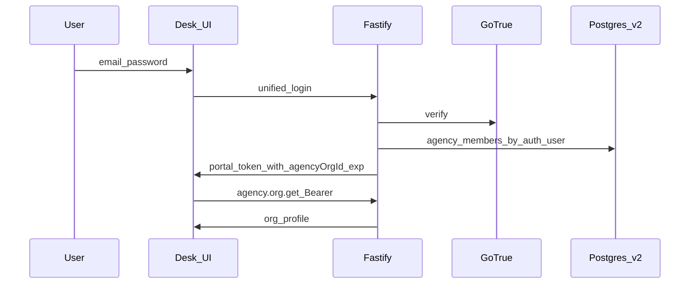
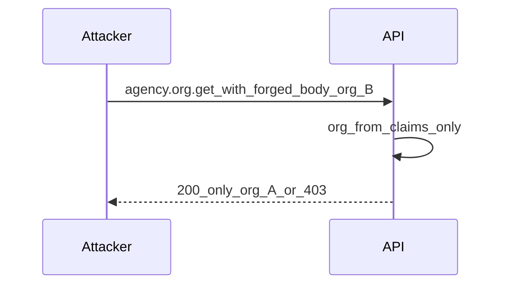

# M01 — Design

**Status:** APPROVED 2026-11-13 (PM cycle — proceed Implement)  
**Migration (planned):** `v2/packages/db/migrations/00XX_agency_orgs.sql` (next free number at implement time)  
**Drizzle:** extend `v2/packages/db/src/schema.ts`

---

## 1. Data model

### 1.1 `v2.agency_orgs`

| Column | Type | Null | Notes |
|--------|------|------|-------|
| id | uuid PK | N | `gen_random_uuid()` |
| slug | citext | N | unique, e.g. `soultrips` |
| name | text | N | display |
| brand_json | jsonb | N | default `{}` — logo/colors later |
| status | text | N | `active` \| `suspended` |
| created_at | timestamptz | N | now() |
| updated_at | timestamptz | N | now() |

Check: `status IN ('active','suspended')`  
Unique: `slug`

### 1.2 `v2.agency_members`

| Column | Type | Null | Notes |
|--------|------|------|-------|
| id | uuid PK | N | |
| agency_org_id | uuid FK → agency_orgs | N | ON DELETE CASCADE |
| auth_user_id | uuid | N | GoTrue user id |
| role | text | N | `owner` \| `ops` \| `finance` \| `viewer` |
| display_name | text | N | |
| is_primary | boolean | N | default false |
| status | text | N | `active` \| `invited` \| `disabled` |
| created_at | timestamptz | N | |
| updated_at | timestamptz | N | |

Unique: `(agency_org_id, auth_user_id)`  
Check role/status enums.

### 1.3 `v2.agency_org_hotel_links`

| Column | Type | Null | Notes |
|--------|------|------|-------|
| id | uuid PK | N | |
| agency_org_id | uuid FK | N | |
| property_id | uuid FK → v2.properties | N | |
| agent_id | uuid | N | Hotel B2B agent id used for holds (v2.agents or documented bridge) |
| status | text | N | `active` \| `ended` |
| created_at | timestamptz | N | |

Unique: `(agency_org_id, property_id)` WHERE status = active (partial unique index)

**Note at implement:** Confirm whether MoU agent rows live in `v2.agents` today; FK only if table/column exists. Otherwise `agent_id uuid NOT NULL` without FK + comment, validated in app against existing agent store — **do not invent public.agents FK from v2_app** (ADR 001).

### 1.4 Indexes

```sql
CREATE UNIQUE INDEX agency_orgs_slug_uidx ON v2.agency_orgs (slug);
CREATE INDEX agency_members_org_idx ON v2.agency_members (agency_org_id) WHERE status = 'active';
CREATE UNIQUE INDEX agency_members_org_user_uidx ON v2.agency_members (agency_org_id, auth_user_id);
CREATE INDEX agency_members_auth_user_idx ON v2.agency_members (auth_user_id) WHERE status = 'active';
CREATE INDEX agency_org_hotel_links_org_idx ON v2.agency_org_hotel_links (agency_org_id) WHERE status = 'active';
CREATE UNIQUE INDEX agency_org_hotel_links_org_property_active_uidx
  ON v2.agency_org_hotel_links (agency_org_id, property_id) WHERE status = 'active';
CREATE INDEX agency_org_hotel_links_property_idx ON v2.agency_org_hotel_links (property_id) WHERE status = 'active';
```

### 1.5 Grants / RLS

- `GRANT SELECT, INSERT, UPDATE, DELETE ON ... TO v2_app;`
- Enable RLS; policies for direct SQL optional if all access is via API as `v2_app` — **app-layer assert is mandatory**:
  - `assertAgencyMember(actor, orgId)`
  - Hotel staff tokens must fail agency commands

Seed (migration or one-shot script documented in implement notes):

- Org `soultrips` / Soultrips  
- Member: auth user for `soultrip@gmail.com` as `owner`, `is_primary=true`  
- Hotel link: Pelbu Olakha `property_id` + MoU `agent_id` used today for Soultrips  

---

## 2. Token / session Design (Phase A only)

### 2.1 Claims (portal agent)

```ts
{
  v: 1,
  role: "agent" | "guide" | "driver",
  propertyId: string,       // last MoU hotel context (optional for pure agency later)
  agencyOrgId?: string,     // required for role=agent
  subjectId: string,
  portalAccountId?: string,
  iat: number,              // unix seconds
  exp: number               // iat + 28800 (8h) default; configurable
}
```

### 2.2 Verify rules (`desk-token.ts`)

1. Parse HMAC; timing-safe compare (replace `===`).  
2. Reject if `exp` missing or `exp < now`.  
3. Boot: if `DESK_JWT_SECRET` missing or equals `hos-v2-desk-dev` and `NODE_ENV===production` → exit 1.  
4. Dev may use default only when `ALLOW_DEV_DESK_JWT_SECRET=1`.

### 2.3 Permission matrix additions

File: `v2/packages/domain/src/permissions/index.ts` (or adjacent)

| Role | Grants (M01 minimum) |
|------|----------------------|
| agent | `agency.org.read`, `agency.members.read`, `agency.hotelLinks.read`, existing partner read grants as applicable |
| guide | `guide.assignment.read` (stub for M11) |
| driver | `driver.assignment.read` (stub) |

Mutations for invite: `agency.members.invite` → owner only.

### 2.4 Sensitive GETs to gate (implement checklist)

From live API inventory — require `verifyDeskToken` + property match (or agency match):

- `/v1/partners/snapshot`
- `/v1/rates/snapshot`
- `/v1/desk/day` (and stays/guests/groups variants used by desk)
- `/v1/outbox` / live stream if property-scoped PII

Exact route list: confirm in `v2/apps/api/src/index.ts` at implement; do not leave partners snapshot public.

### 2.5 Demo field PINs

`field-portal-auth.ts`: if `!env.ALLOW_E2E_DEMO_AUTH`, reject demo codes; remove hardcoded PIN constants from production bundle path (tree-shake or `if (import.meta.env.DEV)`).

### 2.6 Bind helper

```ts
function agencyOrgIdFromActor(actor: Actor): string // throws FORBIDDEN if missing
// Never accept body.agencyOrgId unless equals claims
```

Partner commands that take `viewerAgentId`: resolve agent from `agency_org_hotel_links` for `actor.agencyOrgId` + property — **ignore client agent id** or require equality.

---

## 3. API contracts (Zod sketch)

```ts
agencyOrgGetInput = z.object({}) // org from actor
agencyOrgGetOutput = z.object({
  id: z.string().uuid(),
  slug: z.string(),
  name: z.string(),
  status: z.enum(["active", "suspended"]),
})

agencyMembersListOutput = z.object({
  members: z.array(z.object({
    id: z.string().uuid(),
    displayName: z.string(),
    role: z.enum(["owner", "ops", "finance", "viewer"]),
    status: z.enum(["active", "invited", "disabled"]),
    isPrimary: z.boolean(),
  })),
})

agencyHotelLinksListOutput = z.object({
  links: z.array(z.object({
    propertyId: z.string().uuid(),
    propertyName: z.string(),
    agentId: z.string().uuid(),
    status: z.literal("active"),
  })),
})
```

Invite (if in M01 implement):

```ts
agencyMembersInviteInput = z.object({
  email: z.string().email(),
  role: z.enum(["ops", "finance", "viewer"]),
  idempotencyKey: z.string().uuid(),
})
```

Errors: `NO_AGENCY_ORG` | `ORG_SUSPENDED` | `FORBIDDEN` | `UNAUTHORIZED` | `VALIDATION`

---

## 4. UI (minimal — not Travel Agent OS chrome rewrite)

| Route | Controls | States |
|-------|----------|--------|
| `/partner` | Existing shell; header shows **org name** from `agency.org.get` | loading skeleton; error toast; empty “No agency org” → sign out CTA |
| `/partner/settings` (new lightweight) | Members table (read); Hotel links list | empty members; forbidden |

**Clicks**

1. Sign in → home `/partner` → fetch org (auto).  
2. Nav Settings → members list.  
3. Sign out → clear session → `/login`.

No trip nav required in M01.

---

## 5. Sequences

### Happy — agent login



### Deny — cross org



---

## 6. Unit tests (write first)

| Test name | Asserts |
|-----------|---------|
| `desk_token_rejects_missing_exp` | verify fails |
| `desk_token_rejects_expired` | verify fails |
| `desk_token_accepts_valid_exp` | verify ok |
| `agency_org_id_from_actor_requires_claim` | throws |
| `permissions_agent_has_agency_org_read` | true |
| `demo_field_pin_disabled_without_flag` | false |

## 7. Integration tests

| Name | Asserts |
|------|---------|
| `member_A_cannot_read_org_B` | 403 |
| `soultrips_seed_org_get_ok` | 200 name |
| `partners_snapshot_requires_auth` | 401 without token |

## 8. E2E (module-scoped)

| Spec | Steps |
|------|-------|
| `agency-m01-login-org.spec.ts` | Login soultrip → `/partner` → see org name in header/settings |

Not full trip journey.

---

## 9. Implement file touch list (expected)

- `v2/packages/db/migrations/00XX_agency_orgs.sql`
- `v2/packages/db/src/schema.ts`
- `v2/apps/api/src/platform/desk-token.ts`
- `v2/packages/domain/src/permissions/*`
- `v2/apps/api/src/modules/auth-*.ts` (claims)
- `v2/apps/api/src/modules/agency-org.ts` (new)
- `v2/apps/api/src/index.ts` (GET gates + command register)
- `v2/apps/desk/src/lib/field-portal-auth.ts`
- Thin settings UI under partner

## 10. Production notes (fill in 05 later)

- `pnpm migrate:v2:additive` on droplet  
- Restart api/desk  
- Smoke: login soultrip, org name visible  
- Rollback: migration down not required if additive-only; feature flag `AGENCY_ORG_ENFORCE=0` optional escape hatch for one release  

## 11. Explicit non-goals in this Design

- Cookie Phase B  
- Redis jti revoke  
- Full Partner IA routes from blueprint  
